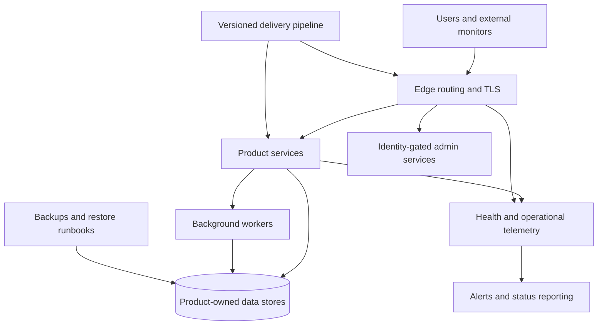

# Allsort Platform Blueprint

Reference architecture and operating practices for running a small portfolio of
independent software products with production discipline.

This repository explains the reusable ideas behind Allsort's platform work:
safe delivery, explicit trust boundaries, observable services, recoverable data,
and security checks that can be adopted incrementally. It is a sanitized
reference, not a copy of production configuration.

## What this demonstrates

- Product and platform decisions expressed as testable operating constraints.
- A deployment path with candidate validation, atomic cutover, verification,
  and rollback.
- Shared security automation with immutable references and verified tooling.
- Practical observability, backup, restore, and incident-response expectations.
- A small-team model that favors understandable systems over unnecessary
  platform complexity.

## Architecture at a glance



The boundaries and responsibilities are described in
[Platform architecture](docs/architecture.md).

## Repository map

| Path | Purpose |
| --- | --- |
| [`docs/architecture.md`](docs/architecture.md) | Components, boundaries, ownership, and data flow |
| [`docs/delivery.md`](docs/delivery.md) | Build, validation, cutover, verification, and rollback |
| [`docs/security.md`](docs/security.md) | Supply-chain, secrets, identity, and runtime controls |
| [`docs/reliability.md`](docs/reliability.md) | Health, monitoring, backup, restore, and incidents |
| [`docs/decisions/`](docs/decisions/) | Short architecture decision records |
| [`examples/`](examples/) | Generic configuration patterns, never production values |
| [`scripts/check_docs.py`](scripts/check_docs.py) | Offline documentation and safety checks |

## Use this blueprint

Start with the controls that prevent irreversible failures:

1. Define service ownership and data boundaries.
2. Make builds reproducible and keep deployment credentials out of artifacts.
3. Validate a candidate before switching traffic.
4. Verify the live release and retain a tested rollback path.
5. Add health checks and actionable alerts.
6. Back up product data and rehearse restoration.
7. Centralize repeatable security checks while letting each product choose its
   rollout cadence.

The examples deliberately use placeholders. Copy the patterns, then adapt
resource limits, retention, recovery objectives, and approval gates to the
actual product risk.

## Validate the repository

```bash
python scripts/check_docs.py
```

The check runs without network access. It validates internal Markdown links,
rejects accidental private-key material, and ensures examples retain explicit
placeholder values.

## Scope

This repository is documentation and reference configuration. It does not
contain production addresses, credentials, customer data, inventory, or an
authoritative disaster-recovery plan. Product repositories remain responsible
for application-specific deployment and data recovery.
