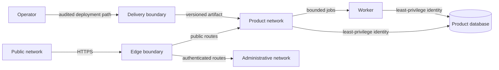

# Platform architecture

## Design intent

The platform supports several independently deployable products without
turning a small operating environment into a miniature cloud provider. Shared
components handle cross-cutting concerns. Product repositories retain control
of application releases and product data.

## Responsibility map

| Layer | Owns | Does not own |
| --- | --- | --- |
| Edge | TLS termination, routing, request boundaries | Product authentication or business authorization |
| Identity gateway | Administrative access policy and second-factor enforcement | End-user product accounts |
| Product service | Application behavior, schema, migrations, health contract | Shared edge configuration |
| Product data | Product records, retention, backup, restoration | Data belonging to another product |
| Platform operations | Host posture, shared telemetry, platform runbooks | Undocumented application recovery |
| Delivery pipeline | Artifact integrity, candidate checks, cutover, live verification | Bypassing product acceptance criteria |

This separation makes failures easier to reason about. A product release should
not rewrite shared edge state, and a platform change should not silently mutate
product data.

## Trust boundaries

Key constraints:

- Administrative interfaces are not protected only by obscurity or uncommon
  hostnames.
- Product services receive only the secrets and network access they require.
- Background workers cannot become an undocumented administrative path.
- Delivery credentials are available only to protected deployment contexts.
- A build artifact is immutable between candidate validation and live cutover.

## Product-owned delivery

Application repositories build and validate their own release artifacts. The
shared platform supplies edge routing, host-level constraints, and operational
contracts. This keeps product releases independent while preserving consistent
minimum controls.

Each service publishes:

- a health endpoint with a documented meaning;
- a version or release identifier;
- resource and filesystem expectations;
- migration and rollback constraints;
- backup and restoration ownership;
- a list of required runtime secrets by name, never value.

## Failure containment

The desired failure unit is one product release. Separate networks, product
data stores, health contracts, and deployment concurrency controls reduce the
chance that a routine change becomes a platform-wide event.
