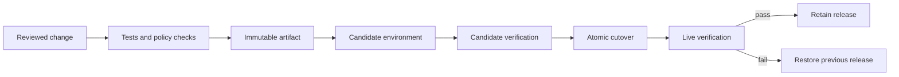

# Delivery and rollback

## Release contract

A release is a versioned artifact plus the information required to verify and
operate it. Rebuilding during deployment creates a second, unreviewed artifact
and breaks that contract.

## Gates

### Before packaging

- Unit, integration, and static checks appropriate to the service pass.
- Dependency and secret scans run in a context that cannot deploy.
- Workflow dependencies are pinned to immutable revisions.
- Generated artifacts are reproducible from the reviewed revision.

### Before cutover

- Configuration is complete and contains no placeholder values.
- The candidate starts with its production runtime identity and filesystem
  restrictions.
- Health checks pass and expected routes return the correct status.
- A migration is either backward compatible or paired with an explicit rollback
  decision.

### After cutover

- Verify the externally served release identifier and critical paths.
- Compare served static artifacts when byte-for-byte verification is feasible.
- Confirm monitoring sees the new release.
- Preserve the previous known-good release until verification completes.

## Rollback principles

Rollback is a first-class release operation, not an improvised response.

- Deploy and rollback share a concurrency control.
- Operators select a known release identifier rather than an arbitrary path.
- The rollback process validates the target before changing traffic.
- The previous release remains available for a bounded retention window.
- Data migrations document whether application rollback is safe.

## Evidence

A useful release record answers:

1. What source revision produced the artifact?
2. Which checks passed?
3. Who or what initiated deployment?
4. Which release was previously live?
5. What did live verification observe?
6. Was rollback required?

The record should help an operator make a decision during an incident, not only
satisfy an audit after the fact.
